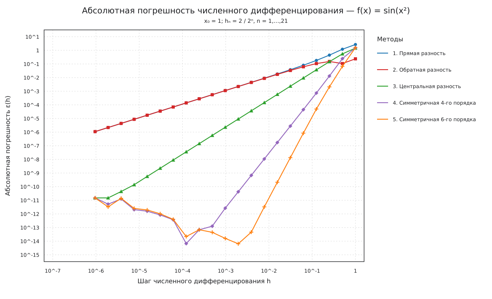
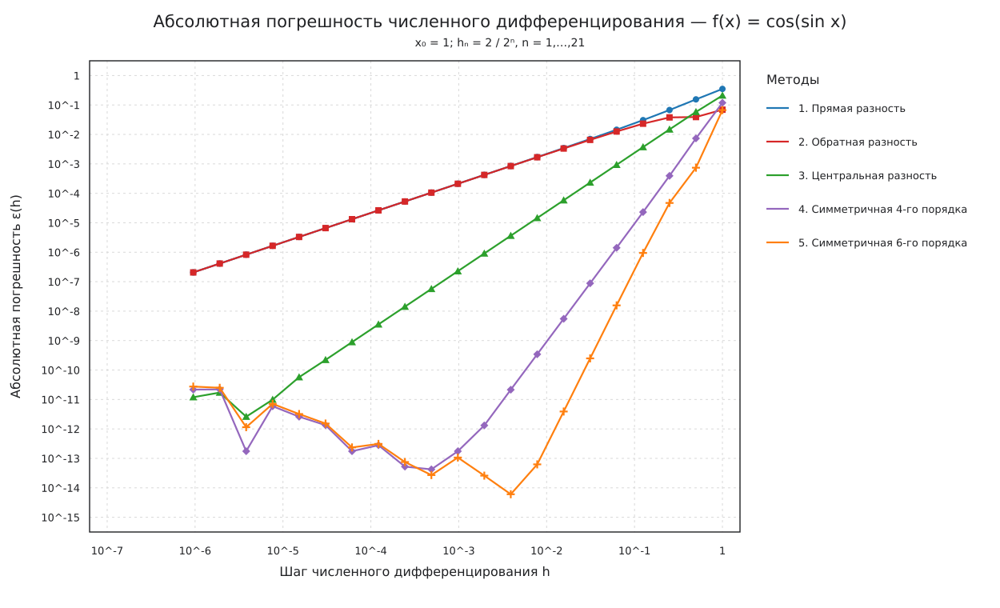
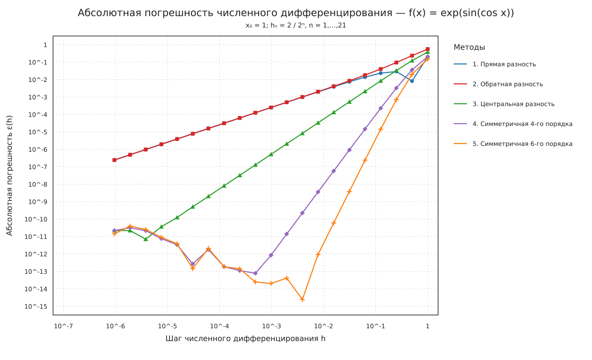
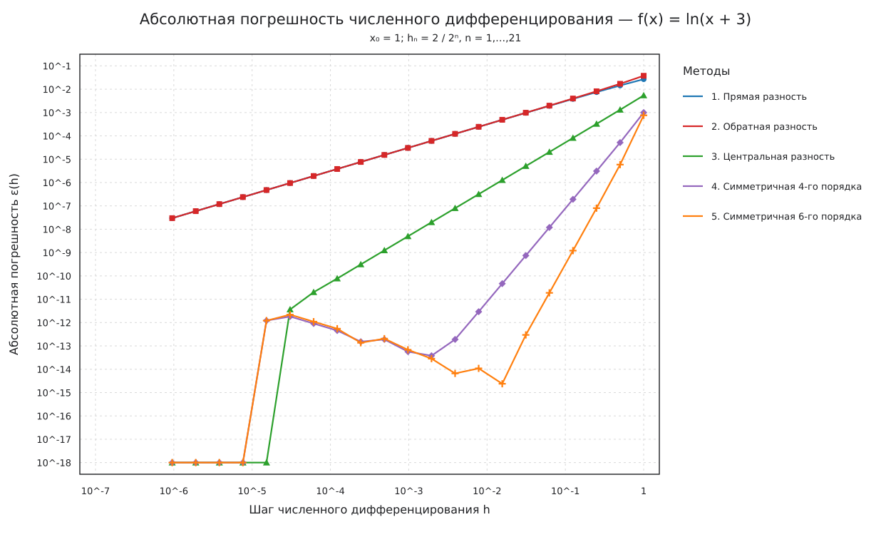
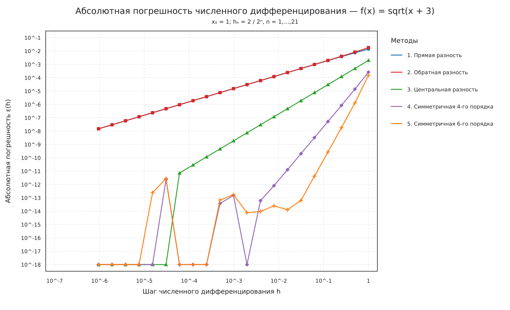

# Лабораторная работа: численное дифференцирование

## Цель работы

Исследовать зависимость абсолютной погрешности пяти формул численного дифференцирования от шага (h) на логарифмических графиках.

## Исходные данные

В соответствии с заданием используются

\[
h_n=\frac{2}{2^n},\qquad n=1,\ldots,21.
\]

Точка вычисления в фотографии задания не видна; в расчёте принято (x_0=1). Скрипт позволяет изменить её параметром `--x0`.

Исследуемые функции:

\[
\sin(x^2),\quad \cos(\sin x),\quad e^{\sin(\cos x)},\quad \ln(x+3),\quad \sqrt{x+3}.
\]

## Формулы

1. Прямая разность:
   \[
   D_1 f(x)=\frac{f(x+h)-f(x)}{h}.
   \]
2. Обратная разность:
   \[
   D_2 f(x)=\frac{f(x)-f(x-h)}{h}.
   \]
3. Центральная разность:
   \[
   D_3 f(x)=\frac{f(x+h)-f(x-h)}{2h}.
   \]
4. Симметричная формула:
   \[
   D_4 f(x)=\frac43\frac{f(x+h)-f(x-h)}{2h}
   -\frac13\frac{f(x+2h)-f(x-2h)}{4h}.
   \]
5. Симметричная формула:
   \[
   D_5 f(x)=\frac32\frac{f(x+h)-f(x-h)}{2h}
   -\frac35\frac{f(x+2h)-f(x-2h)}{4h}
   +\frac1{10}\frac{f(x+3h)-f(x-3h)}{6h}.
   \]

Для каждой функции строится отдельный рисунок. На каждом рисунке находятся ровно пять кривых — по одной для каждой формулы.

## Аналитические производные

\[
\begin{aligned}
\frac{d}{dx}\sin(x^2)&=2x\cos(x^2),\\
\frac{d}{dx}\cos(\sin x)&=-\sin(\sin x)\cos x,\\
\frac{d}{dx}e^{\sin(\cos x)}&=-e^{\sin(\cos x)}\cos(\cos x)\sin x,\\
\frac{d}{dx}\ln(x+3)&=\frac1{x+3},\\
\frac{d}{dx}\sqrt{x+3}&=\frac1{2\sqrt{x+3}}.
\end{aligned}
\]

Абсолютная погрешность каждой формулы вычисляется как

\[
\varepsilon(h)=\left|D_hf(x_0)-f'(x_0)\right|.
\]

## Запуск

```bash
python3 numerical_differentiation_lab.py
```

Результаты сохраняются в каталоге `numerical_differentiation_results/`: пять PNG-графиков и `summary.md` со значениями минимальных ошибок. Если точка должна быть другой:

```bash
python3 numerical_differentiation_lab.py --x0 2
```

## Результаты











## Вывод

Для малых шагов сначала уменьшается погрешность аппроксимации, однако при дальнейшем уменьшении шага начинает проявляться ошибка округления. Поэтому на каждом графике обычно наблюдается минимум. Прямая и обратная разности имеют первый порядок точности, центральная разность — второй; симметричные формулы 4 и 5 дают более высокий порядок аппроксимации и достигают меньшей погрешности до того, как начинают доминировать ошибки округления.
